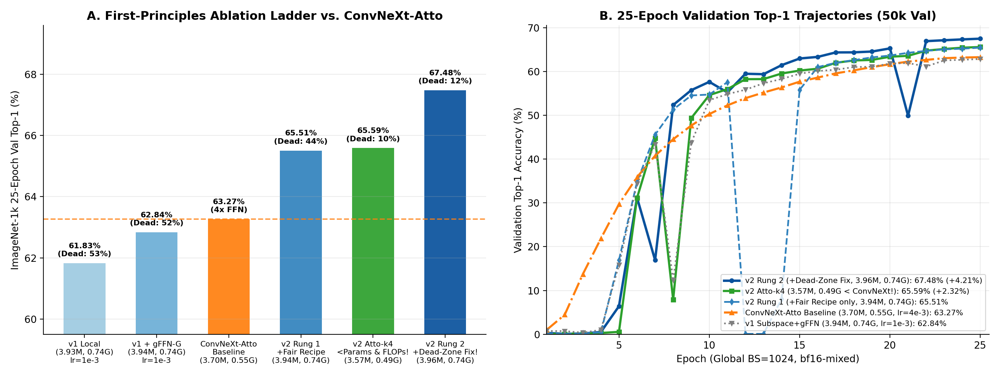
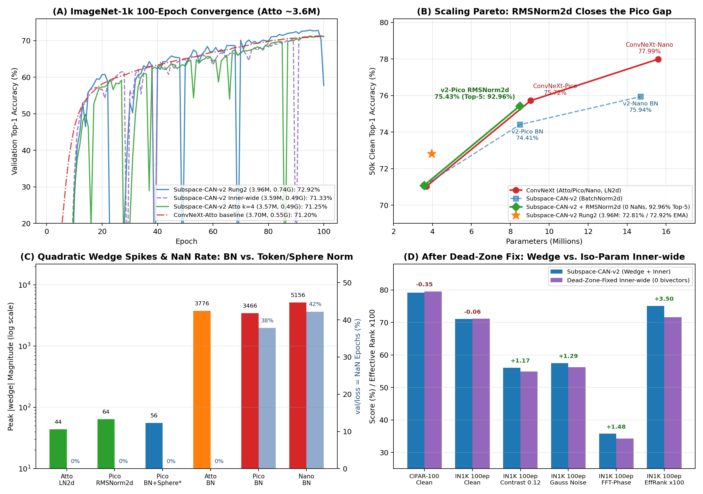

# CliffordNet

ImageNet-1k and CIFAR-100 classification with Clifford algebra vision backbones, covering **CliffordNet / CAN** (`arXiv:2601.06793`) and an open-source PyTorch + Triton reproduction and ablation study of **Subspace Clifford Networks** (`arXiv:2610.37226`). Built with PyTorch Lightning.

## Subspace Clifford Networks (`arXiv:2610.37226`): reproduction, Triton kernel, and 60-run study

Using an AI coding agent (GitHub Copilot CLI) on an 8x H800 node, we reconstructed Subspace Clifford Networks to exact parameter parity across all 13 hierarchical configurations in `arXiv:2610.37226`, wrote a recomputation-based Triton kernel (`k in {2, 3, 4}`, `fp32` and `bf16`, NCHW and `channels_last`, `torch.compile(fullgraph=True)`), and ran **60 full training runs** (32 x 200-epoch CIFAR-100 runs + 28 ImageNet-1k `bf16` DDP runs across 10, 25, 90, and 100 epochs, scaling from `3.57M` Atto to `8.49M` Pico and `14.69M` Nano):

- **Fixing the `SiLU` negative dead-zone (`Subspace-CAN-v2`):** Unnormalized `DWConv3x3` + `diff` mode ($V = Z_2 - Z_1 \approx -Z_1$) trapped `50%` to `55%` of deep-stage inner inputs below `-1.28` (`|Wedge|/|Dot| = 18.3x`). Adding post-DWConv normalization, switching to `ctx_mode="abs"` (which preserves $Z_1 \wedge Z_2$ identically), restoring `1x1` biases, and adding `7x7` spatial diffusion + linear-$O(N)$ global context (`+gFFN-G`) lifted 25-epoch ImageNet-1k Top-1 to **`67.48%`** (`72.92%` at 100 epochs, `3.96M`), while the rebalanced **`Subspace-CAN-v2-Atto`** (`3.57M`, `0.491 GMACs`) reached **`65.59%`** at 25 epochs and **`71.25%`** at 100 epochs vs. `ConvNeXt-Atto`'s `63.27%` / `71.20%` (`3.70M`, `0.547 GMACs`).
- **Equal-parameter falsification after fixing the dead-zone:** Once inner-branch starvation is removed, equal-parameter `Inner-wide` (zero bivectors) matches `Full (Wedge + Inner)` on clean Top-1 (`79.55%` vs. `79.21%` on CIFAR-100; `71.33%` vs. `71.25%` on 100-epoch ImageNet-1k). Antisymmetric wedge products retain an independent advantage in feature effective rank (`0.751` vs. `0.716`) and corruption/FFT-phase robustness (`+1.17%` to `+3.97%`).
- **Scaling to Pico (`8.5M`) & Nano (`14.7M`) requires per-token `RMSNorm2d` / `LayerNorm2d`:** Because $u \wedge v$ is quadratic and `BatchNorm2d` does not bound single-token outliers, scaling BN-based models to Pico/Nano caused `max |wedge| = 3,466` to `5,156` and `val/loss = NaN` on `38%` to `42%` of 90-epoch validations. Replacing `BatchNorm2d` with zero-copy NHWC `RMSNorm2d` + `split_in_proj` (`1.42x` faster step time at `57.2 ms`) clamped `max |wedge|` to `64.4`, eliminated all `NaN`s (`0 / 90`), and reached **`75.43%` Top-1 / `92.96%` Top-5** at `8.49M / 1.319 GMACs` (beating `ConvNeXt-Pico`'s `92.85%` Top-5 with `6.2%` fewer parameters).

Key documents and code:
- Research report (all 60 runs, positive and negative findings): [`docs/subspace_clifford_research_report.md`](./docs/subspace_clifford_research_report.md)
- Model development and H800 performance tuning playbook: [`docs/engineering_and_tuning_playbook.md`](./docs/engineering_and_tuning_playbook.md)
- Experimental design, per-epoch CSV logs, and reproduction commands: [`experiments/subspace_study/README.md`](./experiments/subspace_study/README.md)
- Result tables (kernel benchmark, corruptions, ImageNet-1k Waves B to F): [`experiments/subspace_study/results/`](./experiments/subspace_study/results/)
- Subspace models, v2 fixes, `RMSNorm2d`, and controls (`inner_wide`, `sym_full`, `bilinear_full`, 2x2 block swap): [`src/cliffordnet/subspace.py`](./src/cliffordnet/subspace.py)
- Fused Triton kernel (`2,994 GB/s` on H800, `2.4x` to `9.6x` faster than `torch.compile`): [`src/cliffordnet/kernels/triton_subspace.py`](./src/cliffordnet/kernels/triton_subspace.py)





## Usage

### Install

```bash
uv sync
```

### Train

The canonical entrypoint is config-driven. Later config files override earlier ones, and `--set key=value` overrides both.

Smoke test:

```bash
uv run cliffordnet-train \
  --config configs/imagenet1k.yaml \
  --config configs/profiles/smoke.yaml \
  --set data.data_dir=./imagenet1k
```

Stable ImageNet-1k workload:

```bash
uv run cliffordnet-train \
  --config configs/imagenet1k.yaml \
  --config configs/profiles/stable_imagenet1k.yaml \
  --set data.data_dir=/t1/imagenet1k
```

Set `training.batch_size=0` to run OOM-aware batch-size probing. The trainer then auto-adjusts `training.accumulate_grad_batches` to reach `training.target_global_batch_size` and scales LR from `optim.base_lr` unless `optim.lr` is set explicitly.

### Local Launcher

```bash
uv run cliffordnet-launch \
  --launcher local \
  --config configs/imagenet1k.yaml \
  --config configs/profiles/stress.yaml \
  --set data.data_dir=/t1/imagenet1k \
  --set runtime.devices=8
```

### Slurm Launcher

Generate and submit a Slurm script:

```bash
uv run cliffordnet-launch \
  --launcher slurm \
  --submit \
  --config configs/imagenet1k.yaml \
  --config configs/profiles/stress.yaml \
  --config configs/profiles/slurm_t1.yaml \
  --set data.data_dir=/t1/imagenet1k \
  --set slurm.account=<account> \
  --set slurm.partition=<partition> \
  --set slurm.nodes=2 \
  --set slurm.gpus_per_node=6
```

`run.sh` is a thin wrapper around the Slurm launcher. `run_training.sh` is a thin wrapper around the local launcher.

### Config Profiles

- `configs/imagenet1k.yaml`: base workload config
- `configs/profiles/smoke.yaml`: tiny offline smoke run
- `configs/profiles/probe.yaml`: short probe model run for quick signal
- `configs/profiles/stress.yaml`: long-running HPC workload profile
- `configs/profiles/stable_imagenet1k.yaml`: conservative recipe for ImageNet-1k loss-spike experiments
- `configs/profiles/slurm_t1.yaml`: site-neutral Slurm defaults

### Resume

By default `checkpoint.resume=auto`. The trainer resumes from `last.ckpt` or `preempted.ckpt` under `run.output_dir/run.name/checkpoints` when present. Set a stable `run.name` to resume a local run; the Slurm launcher freezes `run.name` in the generated script automatically. SIGTERM triggers a `preempted.ckpt` save before exit.

### W&B

W&B is online by default. Each run logs the merged config, detected GPU/CPU/Slurm resources, computed batch/accumulation/LR settings, and a `run_manifest.yaml` artifact. Set `wandb.mode=offline` for offline runs.

### Legacy Entrypoint

```bash
uv run python -m cliffordnet.tasks.imagenet1k --help
```

The canonical ImageNet-1k task lives at `src/cliffordnet/tasks/imagenet1k.py`. New workloads should use `cliffordnet-train` or `cliffordnet-launch`.

### GPU Stress Test

```bash
bash scripts/gpu_stress_test.sh
```

Runs single-GPU tests on each card, then a multi-GPU DDP communication test.

## Repository Layout

- `src/cliffordnet/`: package code and canonical runtime
- `src/cliffordnet/subspace.py`: Subspace Clifford Networks (`arXiv:2610.37226`), `Subspace-CAN-v2` dead-zone and `RMSNorm2d` / sphere-norm variants, deconfounding controls (`inner_wide`, `sym_full`, `bilinear_full`, 2x2 `lie_trotter`/`ggr`), extended diagnostics, and `timm` baseline wrappers
- `src/cliffordnet/kernels/triton_subspace.py`: Recomputation-based fused Triton forward/backward kernels for `k in {2, 3, 4}` (`fp32`/`bf16`, NCHW & `channels_last`, `B*G > 65535` `gridX` support, `torch.compile(fullgraph=True)`)
- `src/cliffordnet/data_cifar.py`: Fast cached CIFAR-100 DataModule and photometric/frequency/phase corruption suite
- `src/cliffordnet/tasks/imagenet1k.py`: ImageNet-1k / unified Lightning task, GPU-vectorized `uint8` and aspect-ratio-preserving `/dev/shm` RAM-cache preprocessing, and model registry
- `configs/`: base configs (`imagenet1k.yaml`, `cifar100.yaml`), workload profiles, parallel experiment specs, and W&B sweeps
- `scripts/`: multi-GPU runners (`run_imagenet1k_long_campaign.py`, `run_parallel_experiments.py`), `/dev/shm` RAM cache builder (`build_in1k_ram_cache.py`), PyTorch bottleneck profiler (`profile_bottleneck.py`), kernel benchmark (`benchmark_subspace_kernel.py`), and corruption evaluation (`eval_corruptions.py`)
- `docs/subspace_clifford_research_report.md`: full 60-run research report (Sections 1 to 8)
- `docs/engineering_and_tuning_playbook.md`: model debugging, Triton/`torch.compile`, and H800 data-pipeline tuning playbook
- `docs/model_development.md`: notes for model-structure and stability experiments
- `docs/h800_acceptance.md`: direct, Slurm, and sweep commands for H800 node acceptance

## Diagnostic Metrics

When `--enable-diagnostics` is on (default), the trainer logs wedge-product health metrics every `--diag-log-interval` steps under the `diag/` prefix. These metrics diagnose numerical stability of the Clifford geometric product.

### Background

The wedge product computes `a*b - c*d` (difference of two products). When `a*b` and `c*d` are nearly equal, subtraction causes catastrophic cancellation, especially in `bf16` (7-bit mantissa). The diagnostics measure how much cancellation occurs and whether the wedge branch still contributes useful signal.

### Cancellation

```
term_a = z_det * z_ctx_rolled          (= a*b)
term_b = z_det_rolled * z_ctx          (= c*d)
rel_diff = |term_a - term_b| / (|term_a| + |term_b| + ε)
```

| Metric | Meaning | Healthy | Concerning |
|--------|---------|---------|------------|
| `cancel/rel_diff_mean` | Average relative difference across all elements. Smaller = more cancellation. | > 0.1 | < 0.01 (wedge is computing near-zero, signal drowned by noise) |
| `cancel/rel_diff_lt1e-2` | Fraction of elements with rel_diff < 1%. Measures how many elements suffer severe cancellation. | < 20% | > 50% (majority of wedge elements are noise) |
| `cancel/rel_diff_lt1e-4` | Fraction with rel_diff < 0.01%. Extreme cancellation where bf16 effective precision is near zero. | < 5% | > 10% |

If `rel_diff_lt1e-2` rises during training, det and ctx branches are learning similar representations and the wedge is degenerating. Increase `--ortho-weight` or switch to `fma` wedge mode.

### Magnitude

| Metric | Meaning | How to read |
|--------|---------|-------------|
| `magnitude/wedge_abs_mean` | Mean |wedge| output | Compare with dot. If wedge << dot (>100x gap), wedge branch contributes almost nothing downstream. |
| `magnitude/wedge_abs_max` | Max |wedge| output | Sudden spikes suggest numerical explosion. Check if accompanied by `inf_count > 0`. |
| `magnitude/dot_abs_mean` | Mean |dot| output (SiLU(a*b)) | Baseline reference for gauging wedge's relative importance. |

The target ratio is `wedge_abs_mean / dot_abs_mean`:
- `0.1 to 3.0`: Healthy. Both branches contribute geometric and gating information.
- `< 0.01`: Wedge degenerate, usually from cancellation or initialization.
- `> 10`: Wedge dominant (for example, `18.3x` in v1 when unnormalized `diff` starved the inner branch, or during BN outlier spikes).

### Health

| Metric | Meaning | Expectation |
|--------|---------|-------------|
| `health/nan_count` | Number of NaN values in wedge output | **Must be 0.** Any nonzero = numerical breakdown. |
| `health/inf_count` | Number of Inf values in wedge output | **Must be 0.** Usually bf16 overflow (values exceeding ±3.39e+38). |

Hard pass/fail indicators. If nonzero, check: (1) whether using `naive` wedge mode, (2) whether learning rate is too high.

### Orthogonality

```
cos_sim = cosine_similarity(z_det, z_ctx, dim=channel)   # per spatial position
ortho/cos_sim_mean = mean(|cos_sim|)
```

| Metric | Meaning | How to read |
|--------|---------|-------------|
| `ortho/cos_sim_mean` | Average channel-wise cosine similarity between det and ctx features | 0 = perfectly orthogonal, 1 = perfectly parallel. Lower is better. |

This metric is causally linked to cancellation: high `cos_sim_mean` → det/ctx learn similar features → `a*b ≈ c*d` → severe cancellation → wedge degenerates. The `--ortho-weight` hyperparameter controls the loss term that pushes this value down.

### Triage Flowchart

```
1. health/nan_count > 0 or inf_count > 0?
   ├─ YES → Stop training. Lower lr or switch wedge_mode.
   └─ NO  → continue ↓

2. cancel/rel_diff_lt1e-2 > 50%?
   ├─ YES → Check ortho/cos_sim_mean
   │        ├─ > 0.5 → Increase --ortho-weight
   │        └─ < 0.3 → Cancellation not from alignment; switch to fma mode
   └─ NO  → continue ↓

3. wedge_abs_mean / dot_abs_mean < 0.01?
   ├─ YES → Wedge branch ineffective (init or gradient issue)
   └─ NO  → Numerically stable, wedge working normally
```
