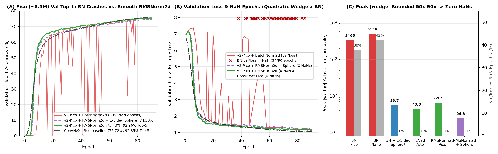

# CliffordNet

ImageNet-1k and CIFAR-100 classification with Clifford algebra vision backbones, covering **CliffordNet / CAN** (`arXiv:2601.06793`) and an open-source PyTorch + Triton reproduction and ablation study of **Subspace Clifford Networks** (`arXiv:2610.37226`). Built with PyTorch Lightning.

## Subspace Clifford Networks (`arXiv:2610.37226`): reproduction, Triton kernel, and 60-run study

Using an AI coding agent (GitHub Copilot CLI) on an 8x H800 node, we reconstructed Subspace Clifford Networks to exact parameter parity across all 13 hierarchical configurations in `arXiv:2610.37226`, wrote a recomputation-based Triton kernel (`k in {2, 3, 4}`, `fp32` and `bf16`, NCHW and `channels_last`, `torch.compile(fullgraph=True)`), and ran **60 full training runs** (32 x 200-epoch CIFAR-100 runs + 28 ImageNet-1k `bf16` DDP runs across 10, 25, 90, and 100 epochs, scaling from `3.57M` Atto to `8.49M` Pico and `14.69M` Nano):

- **Fixing the `SiLU` negative dead-zone (`Subspace-CAN-v2`):** Unnormalized `DWConv3x3` + `diff` mode ($V = Z_2 - Z_1 \approx -Z_1$) trapped `50%` to `55%` of deep-stage inner inputs below `-1.28` (`|Wedge|/|Dot| = 18.3x`). Adding post-DWConv normalization, switching to `ctx_mode="abs"` (which preserves $Z_1 \wedge Z_2$ identically), restoring `1x1` biases, and adding `7x7` spatial diffusion + linear-$O(N)$ global context (`+gFFN-G`) lifted 25-epoch ImageNet-1k Top-1 to **`67.48%`** (`72.92%` at 100 epochs, `3.96M`), while the rebalanced **`Subspace-CAN-v2-Atto`** (`3.57M`, `0.491 GMACs`) reached **`65.59%`** at 25 epochs and **`71.25%`** at 100 epochs vs. `ConvNeXt-Atto`'s `63.27%` / `71.20%` (`3.70M`, `0.547 GMACs`).
- **Equal-parameter falsification after fixing the dead-zone:** Once inner-branch starvation is removed, equal-parameter `Inner-wide` (zero bivectors) matches `Full (Wedge + Inner)` on clean Top-1 (`79.55%` vs. `79.21%` on CIFAR-100; `71.33%` vs. `71.25%` on 100-epoch ImageNet-1k). Antisymmetric wedge products retain an independent advantage in feature effective rank (`0.751` vs. `0.716`) and corruption/FFT-phase robustness (`+1.17%` to `+3.97%`).
- **Scaling to Pico (`8.5M`) & Nano (`14.7M`) requires per-token `RMSNorm2d` / `LayerNorm2d`:** Because $u \wedge v$ is quadratic and `BatchNorm2d` does not bound single-token outliers, scaling BN-based models to Pico/Nano caused `max |wedge| = 3,466` to `5,156` and `val/loss = NaN` on `38%` to `42%` of 90-epoch validations. Replacing `BatchNorm2d` with zero-copy NHWC `RMSNorm2d` + `split_in_proj` (`1.42x` faster step time at `57.2 ms`) clamped `max |wedge|` to `64.4`, eliminated all `NaN`s (`0 / 90`), and reached **`75.43%` Top-1 / `92.96%` Top-5** at `8.49M / 1.319 GMACs` (beating `ConvNeXt-Pico`'s `92.85%` Top-5 with `6.2%` fewer parameters).

Key documents and code:
- Research report (all 60 runs, positive and negative findings): [`docs/subspace_clifford_research_report.md`](./docs/subspace_clifford_research_report.md)
- Model development and H800 performance tuning playbook: [`docs/engineering_and_tuning_playbook.md`](./docs/engineering_and_tuning_playbook.md)
- Experimental design, per-epoch CSV logs, and reproduction commands: [`experiments/subspace_study/README.md`](./experiments/subspace_study/README.md)
- Result tables (kernel benchmark, corruptions, ImageNet-1k Waves B to F): [`experiments/subspace_study/results/`](./experiments/subspace_study/results/)
- Subspace models, v2 fixes, `RMSNorm2d`, and controls (`inner_wide`, `sym_full`, `bilinear_full`, 2x2 block swap): [`src/cliffordnet/subspace.py`](./src/cliffordnet/subspace.py)
- Fused Triton kernel (`2,994 GB/s` on H800, `2.4x` to `9.6x` faster than `torch.compile`): [`src/cliffordnet/kernels/triton_subspace.py`](./src/cliffordnet/kernels/triton_subspace.py)





## Usage

### Install & Test

```bash
uv sync
uv run python -m unittest tests/test_triton_subspace.py tests/test_subspace_models.py
```

### Train

The canonical entrypoint (`cliffordnet-train`) is config-driven. Later config files override earlier ones, and `--set key=value` overrides both.

ImageNet-1k (`Subspace-CAN-v2-Pico`, `RMSNorm2d` + fused Triton kernel, `bf16-mixed`, 4x GPU DDP):

```bash
uv run torchrun --standalone --nproc_per_node=4 -m cliffordnet.train \
  --config configs/imagenet1k.yaml \
  --config configs/profiles/imagenet1k_h800_probe.yaml \
  --set data.data_dir=./imagenet1k \
  --set model.size=in1k_v2_pico_rmsnorm2d_fast \
  --set model.ortho_weight=0.0 \
  --set runtime.devices=4 \
  --set training.batch_size=256 \
  --set training.target_global_batch_size=1024 \
  --set training.max_epochs=90 \
  --set optim.base_lr=4.0e-3
```

CIFAR-100 (200 epochs, single GPU):

```bash
CUDA_VISIBLE_DEVICES=0 uv run cliffordnet-train \
  --config configs/cifar100.yaml \
  --set data.data_dir=./data/cifar100 \
  --set model.size=subspace_hier_k4_v2
```

Smoke test:

```bash
uv run cliffordnet-train \
  --config configs/imagenet1k.yaml \
  --config configs/profiles/smoke.yaml \
  --set data.data_dir=./imagenet1k
```

Set `training.batch_size=0` to run OOM-aware batch-size probing. The trainer then auto-adjusts `training.accumulate_grad_batches` to reach `training.target_global_batch_size` and scales LR from `optim.base_lr` unless `optim.lr` is set explicitly.

### Fast `/dev/shm` RAM Cache, Profiling & Kernel Benchmark

On high-RAM nodes (eliminating CPU JPEG decoding while preserving exact aspect ratios and `BICUBIC` validation parity):

```bash
# 1. Build one-time aspect-ratio-preserving 320x320 uint8 cache in /dev/shm (~374 GiB)
uv run python scripts/build_in1k_ram_cache.py \
  --data-dir ./imagenet1k \
  --out-dir /dev/shm/in1k_raw_cache_ar320 \
  --canvas 320 \
  --workers 128

# 2. Point training at the cache (ImageNet1kDataModule auto-detects train.done/val.done)
#    --set data.data_dir=/dev/shm/in1k_raw_cache_ar320 --set data.num_workers=6
```

Profile CUDA operator time and launch/sync gaps without Nsight, or benchmark the Triton kernel against eager PyTorch and `torch.compile`:

```bash
CUDA_VISIBLE_DEVICES=0 uv run python scripts/profile_bottleneck.py \
  --model in1k_v2_pico_rmsnorm2d_fast --batch-size 256 --compile

CUDA_VISIBLE_DEVICES=0 uv run python scripts/benchmark_subspace_kernel.py
```

### Local & Slurm Launchers

Local multi-GPU launcher:

```bash
uv run cliffordnet-launch \
  --launcher local \
  --config configs/imagenet1k.yaml \
  --config configs/profiles/stress.yaml \
  --set data.data_dir=./imagenet1k \
  --set runtime.devices=8
```

Generate and submit a Slurm script:

```bash
uv run cliffordnet-launch \
  --launcher slurm \
  --submit \
  --config configs/imagenet1k.yaml \
  --config configs/profiles/stress.yaml \
  --config configs/profiles/slurm_h800.yaml \
  --set data.data_dir=./imagenet1k \
  --set slurm.account=<account> \
  --set slurm.partition=<partition> \
  --set slurm.nodes=1 \
  --set slurm.gpus_per_node=8
```

`run.sh` is a thin wrapper around the Slurm launcher. `run_training.sh` is a thin wrapper around the local launcher.

### Config Profiles & Experiment Specs

- `configs/imagenet1k.yaml`: base ImageNet-1k workload config
- `configs/cifar100.yaml`: base CIFAR-100 200-epoch config (`model.ortho_weight=0.0`)
- `configs/profiles/imagenet1k_h800_probe.yaml`: H800 ImageNet-1k `bf16` profile (`ortho_weight=0.0`, fast `uint8` GPU preprocessing)
- `configs/profiles/smoke.yaml`: tiny offline smoke run
- `configs/profiles/probe.yaml`: short probe model run for quick signal
- `configs/profiles/stress.yaml`: long-running HPC workload profile
- `configs/profiles/stable_imagenet1k.yaml`: conservative recipe for early `BatchNorm` / `ortho_weight` stability tests
- `configs/profiles/slurm_h800.yaml` & `configs/profiles/slurm_t1.yaml`: site-neutral Slurm defaults
- `configs/experiments/cifar100_wave*.json`: 8-GPU parallel CIFAR-100 specs for `scripts/run_parallel_experiments.py`

### Resume

By default `checkpoint.resume=auto`. The trainer resumes from `last.ckpt` or `preempted.ckpt` under `run.output_dir/run.name/checkpoints` when present. Set a stable `run.name` to resume a local run; the Slurm launcher freezes `run.name` in the generated script automatically. SIGTERM triggers a `preempted.ckpt` save before exit.

### W&B & SwanLab Tracking

W&B is online by default; set `wandb.mode=offline` for offline local datastores. Each run saves a merged `run_manifest.yaml` with detected GPU/CPU/Slurm resources and resolved batch/LR settings.

To stream live metrics to SwanLab while keeping offline W&B logs (no extra code changes required):

```bash
--set wandb.mode=offline --set wandb.swanlab=true --set wandb.group=<experiment_group>
```

Historical offline runs can also be backfilled via `uv run python scripts/sync_runs_to_swanlab.py`.

### Legacy Entrypoint & GPU Stress Test

```bash
uv run python -m cliffordnet.tasks.imagenet1k --help
bash scripts/gpu_stress_test.sh
```

New workloads should use `cliffordnet-train` or `cliffordnet-launch`. `gpu_stress_test.sh` runs per-card compute checks followed by a multi-GPU DDP communication test.

## Repository Layout

- `src/cliffordnet/`: package code and canonical runtime
- `src/cliffordnet/subspace.py`: Subspace Clifford Networks (`arXiv:2610.37226`), `Subspace-CAN-v2` dead-zone and `RMSNorm2d` / sphere-norm variants, deconfounding controls (`inner_wide`, `sym_full`, `bilinear_full`, 2x2 `lie_trotter`/`ggr`), extended diagnostics, and `timm` baseline wrappers
- `src/cliffordnet/kernels/triton_subspace.py`: Recomputation-based fused Triton forward/backward kernels for `k in {2, 3, 4}` (`fp32`/`bf16`, NCHW & `channels_last`, `B*G > 65535` `gridX` support, `torch.compile(fullgraph=True)`)
- `src/cliffordnet/data_cifar.py`: Fast cached CIFAR-100 DataModule and photometric/frequency/phase corruption suite
- `src/cliffordnet/tasks/imagenet1k.py`: ImageNet-1k / unified Lightning task, GPU-vectorized `uint8` and aspect-ratio-preserving `/dev/shm` RAM-cache preprocessing, and model registry
- `configs/`: base configs (`imagenet1k.yaml`, `cifar100.yaml`), workload profiles, parallel experiment specs, and W&B sweeps
- `scripts/`: multi-GPU runners (`run_imagenet1k_long_campaign.py`, `run_parallel_experiments.py`), `/dev/shm` RAM cache builder (`build_in1k_ram_cache.py`), PyTorch bottleneck profiler (`profile_bottleneck.py`), kernel benchmark (`benchmark_subspace_kernel.py`), and corruption evaluation (`eval_corruptions.py`)
- `docs/subspace_clifford_research_report.md`: full 60-run research report (Sections 1 to 8)
- `docs/engineering_and_tuning_playbook.md`: model debugging, Triton/`torch.compile`, and H800 data-pipeline tuning playbook
- `docs/model_development.md`: notes for model-structure and stability experiments
- `docs/h800_acceptance.md`: direct, Slurm, and sweep commands for H800 node acceptance

## Diagnostic Metrics

When `model.enable_diagnostics=true` (default), the trainer logs geometric-product health metrics every `model.diag_log_interval` steps under the `diag/` prefix.

### Background

The wedge product computes `a*b - c*d` (difference of two products). When `a*b` and `c*d` are nearly equal, subtraction causes catastrophic cancellation in `bf16` (7-bit mantissa). In addition, because the geometric product is quadratic ($O(M^2)$), unbounded spatial outliers under `BatchNorm2d` can explode wedge activations and corrupt BN running statistics. The diagnostics track both cancellation and magnitude/spectrum health.

### Cancellation & Invariance

```
term_a = u_i * v_j
term_b = u_j * v_i
rel_diff = |term_a - term_b| / (|term_a| + |term_b| + ε)
```

| Metric | Meaning | Healthy | Concerning |
|--------|---------|---------|------------|
| `cancel/rel_diff_mean` | Average relative difference across all bivector terms. | > 0.1 | < 0.01 (wedge computing near-zero) |
| `cancel/rel_diff_lt1e-2` | Fraction of terms with `rel_diff < 1%`. | < 5% (typically `~0.4%` with `fp32` FMA) | > 50% (majority of wedge terms are noise) |
| `cancel/rel_diff_lt1e-4` | Fraction with `rel_diff < 0.01%`. | < 1% | > 10% |
| `invariance/lambda_wedge_rel_err` | Relative error between `u ^ (z2 - u)` and `u ^ z2` in stream dtype. | < 0.05 | > 1.0 (use `wedge_mode=fma` or `ctx_mode=abs`) |

### Magnitude & Feature Spectrum

| Metric | Meaning | How to read |
|--------|---------|-------------|
| `magnitude/wedge_abs_mean` | Mean `|wedge|` output | Compare with `dot_abs_mean` via `magnitude/wedge_to_dot_ratio`. |
| `magnitude/wedge_abs_max` | Peak `|wedge|` output | Healthy is `< 100` (`~44–64` under `LN2d`/`RMSNorm2d`). Values `> 1,000` under `BatchNorm2d` signal quadratic outlier spikes that trigger `val/loss = NaN`. |
| `magnitude/dot_abs_mean` | Mean `|dot|` output (`SiLU(u*v)`) | Baseline reference for gauging inner vs. wedge balance. |
| `magnitude/wedge_to_dot_ratio` | `wedge_abs_mean / dot_abs_mean` | Target `0.5 to 3.5`. `> 10` means inner branch is starved (for example `18.3x` in v1 `diff` dead-zone); `< 0.01` means wedge is degenerate. |
| `spectrum/effective_rank` | Normalized SVD entropy effective rank of block output in `(0, 1]` | Higher is richer (`~0.70–0.75` on ImageNet-1k); sudden drop signals feature collapse. |

### Health & Orthogonality

| Metric | Meaning | Expectation |
|--------|---------|-------------|
| `health/nan_count` / `health/inf_count` | Number of `NaN` / `Inf` values in geometric-product outputs | **Must be 0.** |
| `ortho/cos_sim_mean` | Mean `|cos(z_state, z_ctx)|` across channels | Lower is more orthogonal. |
| `ortho/subspace_cos_sim_mean` | Mean `|cos(u, v)|` inside each $k$-dimensional subspace | Lower reduces cancellation. |

> **Note on `model.ortho_weight`:** All 60 runs in our Subspace Clifford study used `model.ortho_weight=0.0` (standard cross-entropy only). With `RMSNorm2d` / `LayerNorm2d` and `fp32` FMA determinants inside the `bf16` Triton kernel, cancellation stays around `0.4%` naturally without needing an auxiliary orthogonality loss.

### Triage Flowchart

```
1. health/nan_count > 0, inf_count > 0, or val/loss = NaN?
   ├─ YES → Check magnitude/wedge_abs_max:
   │        ├─ > 500 with BatchNorm2d → Replace BN with RMSNorm2d/LayerNorm2d (or add onesided_sphere)
   │        └─ Otherwise → Ensure model.wedge_mode=fma and check inner gate (use SiLU(u*v), not SiLU(u)*v)
   └─ NO  → continue ↓

2. magnitude/wedge_to_dot_ratio > 10?
   ├─ YES → Inner branch starved by SiLU <-1.28 dead-zone (unnormalized DWConv + diff).
   │        Enable ctx_bn=True, ctx_mode="abs", proj_bias=True.
   └─ NO  → continue ↓

3. cancel/rel_diff_lt1e-2 > 50%?
   ├─ YES → Verify model.wedge_mode=fma; if ortho/cos_sim_mean > 0.5, optionally set model.ortho_weight=0.01.
   └─ NO  → Numerically stable and balanced.
```
