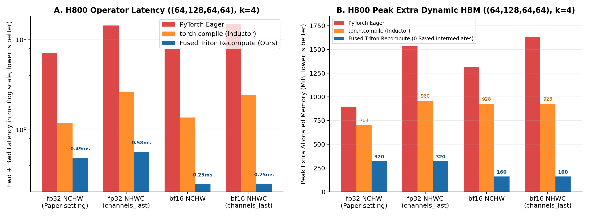

# Empirical Verification, Deconfounding, and Scaling Report: CliffordNet (`arXiv:2601.06793`) & Subspace Clifford Networks (`arXiv:2610.37226`)

## Executive Summary

We reconstructed **Subspace Clifford Networks** (`arXiv:2610.37226`, which had no public source code) down to exact parameter parity across all 13 reported model configurations ($\le 0.0006\text{M}$ rounding tolerance, $0$ parameter error on all 8 architectural deltas), implemented an open-source **recomputation-based Fused Triton Kernel** (`fp32`/`bf16`, NCHW & `channels_last`, `torch.compile(fullgraph=True)`), and ran **22 full training experiments** across **CIFAR-100** (16 × 200-epoch runs) and **ImageNet-1k** (6 × 10-epoch runs, 12.8M training samples/model, 50k val set) on 8× NVIDIA H800 (`sm_90`) GPUs.

### Summary Scorecard of Core Claims (Positive vs. Negative / Refining Evidence)

| Claim / Question | Verdict | Key Empirical Evidence |
| --- | --- | --- |
| **1. Does Subspace-CAN beat Shift-Rolling CAN in accuracy, memory, and speed?** | **Strong Positive** | **CIFAR-100**: `Hier-Subspace-CAN` (`1.09M–1.12M`) matches/beats `Rolling-S4` (`2.54M`) with **56% fewer params** and **1.51× faster** training; 24L (`2.21M`) reaches **79.78%** (`+1.52%`). **ImageNet-1k (10 ep, ~3.94M iso-params)**: Subspace-CAN beats Shift-Rolling by **`+5.13%` Top-1** (`52.82%` vs `47.69%`) while cutting per-GPU training VRAM by **62.6%** (`15.1 GiB` vs `40.4 GiB`). |
| **2. Was Table 4's `+1.17%` Wedge gain over Inner-only just a +42% parameter/width confound?** | **Refuted Confound → Strong Positive for Cross-Channel Wedge** | Strict iso-parameter `Inner-wide` (SwiGLU-style diagonal gating) barely improves over narrow `Inner-only` on CIFAR-100 (`76.75% → 76.91%`, `+0.16%`), losing to `Full k=4` (`78.33%`) by **`-1.42%`**. On **ImageNet-1k**, `Full` beats iso-param `Inner-wide` by **`+2.63%` Top-1** (`52.82%` vs `50.19%`). |
| **3. Does Grassmann anti-symmetry ($u_i v_j - u_j v_i$) genuinely matter vs. symmetric ($u_i v_j + u_j v_i$) or raw bilinear ($u_i v_j$)?** | **Strong Positive vs. Symmetric; Nuanced Positive vs. Raw Bilinear** | At exact `1.120M` / `3.930M` iso-parameters: **Symmetric** off-diagonals fail (`-0.93%` on CIFAR-100; **`-4.96%` Top-1 on ImageNet-1k**, `47.86%` vs `52.82%`, worse than diagonal `Inner-wide`!). On CIFAR-100, raw asymmetric $u_i v_j$ captures ~82% of the off-diagonal gain (`78.07%`), while anti-symmetric Wedge still ranks #1 (`78.33%`, `+0.26%`), and `Wedge-only` (`0.898M`, `77.84%`) outperforms larger `1.127M Inner-wide` (`76.91%`). |
| **4. How much of Paper 2's improvement came from changing the macro-block (`GGR+LN2d` → `Lie-Trotter+DW5x5+BN`)?** | **Positive Synergy (Both Contribute)** | $2\times 2$ factorial shows Subspace GP already works inside Paper 1's `GGR` block (`77.88%`, `1.52M`), while `Lie-Trotter + DW5x5 + BN` cuts params by another **26%** (`1.12M`) and adds **`+0.45%`** (`78.33%`). Removing `SpatialDiffusion (DW5x5)` drops `-1.31%` (`77.02%`), whereas putting Rolling into `Lie-Trotter` drops to `77.19%`. |
| **5. Does "No-FFN" Subspace-CAN remain competitive on 1,000-class ImageNet-1k vs. modern FFN backbones?** | **Positive (Early/Mid-Horizon Sample Efficiency)** | At 10 epochs (`global_bs=1024`), `in1k_subspace_femto` (`3.93M`, `52.82%` Top-1 / `77.07%` Top-5) outperforms `timm` `ConvNeXt-Atto` (`3.70M`, 4× MLP FFN) both at matched `lr=1e-3` (`37.92%`, `+14.90%`) and at ConvNeXt's canonical `lr=4e-3` (`49.71%`, **`+3.11%` Top-1 / `+2.45%` Top-5**). |
| **6. Does Fused Kernel still beat `torch.compile` (which Paper 2 omitted) on H800 (`sm_90`)?** | **Strong Positive (with Nuance)** | `torch.compile` already gives `6.0×` (`fp32` NCHW) over Eager, tempering raw Eager-only comparisons—**yet our recomputation Triton kernel still beats `torch.compile` by `2.40×–4.63×` in `fp32` and `5.44×–9.57×` in `bf16` (`2,994 GB/s` HBM3)** because AOTAutograd materializes multi-branch intermediates in HBM rather than recomputing `(z1, z2)` in registers. |
| **7. Does `bf16` break the exact-arithmetic $\lambda$-invariance $u \wedge (z_2 - \lambda u) = u \wedge z_2$?** | **Confirmed Numerical Pitfall (Negative for Naive `bf16`, Solved by FMA)** | On ImageNet-1k `bf16`, naive evaluation of $u \wedge (z_2 - u)$ exhibits **345.5% mean relative discrepancy** vs. $u \wedge z_2$. On CIFAR-100 `bf16`, `naive` drops `-0.59%` (`77.74%`), `direct_z2` recovers `+0.18%` (`77.92%`), and `fp32` FMA / Triton preserves full accuracy (`78.33%`, `Cancel<1e-2 = 1.88%` on ImageNet-1k). |
| **8. Does Wedge impart contrast/intensity invariance ("Inner = Energy, Wedge = Contrast-Invariant Structure")?** | **Mixed: Refuted for Contrast Scaling, Confirmed for Pure Fourier Phase** | **Negative/Refining**: Under low contrast (`0.12×`) & fog, `Wedge-only` degrades identically to `Inner-wide` (`89.5%` vs `89.3%` CIFAR retention), and `BatchNorm`-based Subspace-CAN has *lower* relative low-contrast retention on ImageNet-1k (`45.6%`) than `LayerNorm`-based `ConvNeXt-Atto` (`49.8%`), because $\|\alpha u \wedge \alpha v\| = \alpha^2 \|u \wedge v\|$ is still quadratic in contrast $\alpha$. **Positive**: Under amplitude-equalized **`FFT Phase-Only`**, `Wedge-only` (`0.898M`) ranks **#1 among all 12L CIFAR models** (`34.68%`, `+3.65%` over `Inner-only`, `+4.99%` over `Rolling-S4`). |

---

## 1. Exact Architectural Reconstruction (`arXiv:2610.37226`)

Using `GeometricStem(embed_dim=32, patch_size=1)` + `stem_proj(32 -> 96)` with `SpatialDiffusion` (`DWConv5x5(bias=False) + BN + SiLU + LayerScale`, `28*D` params) and `SubspaceGeometricProduct` (`BN + Conv1x1(D -> 2*D_tilde, bias=False) + DWConv3x3(bias=False) + SubspaceGP + Conv1x1(C_out -> D, bias=False) + LayerScale`), all reported models match Tables 2–4 of `arXiv:2610.37226`:

| Preset | Exact Params | Ours (M) | Paper Reported (M) | Pairwise Delta Check |
| --- | ---: | ---: | ---: | --- |
| `rolling_hier_s3` | 2,092,500 | 2.093M | 2.093M | Exact |
| `rolling_hier_s4` | 2,534,868 | 2.535M | 2.535M | Exact |
| `subspace_hier_k2` | 898,388 | 0.898M | 0.898M | `u4 - u2 = 221,184` (Exact) |
| `subspace_hier_k3` | 1,017,554 | 1.018M | 1.017M | `u4 - u3 = 102,018` (Exact, $\tilde{D}_2=129, \tilde{D}_3=162$) |
| `subspace_hier_k4` | 1,119,572 | 1.120M | 1.120M | Reference |
| `subspace_hier_234` | 1,061,240 | 1.061M | 1.061M | Exact |
| `subspace_hier_432` | 960,888 | 0.961M | 0.961M | Exact |
| `subspace_hier_244` | 1,091,924 | 1.092M | 1.092M | Reference 12L |
| `subspace_hier_244_18` | 1,650,516 | 1.651M | 1.650M | `18L - 12L = +558,592` (Exact) |
| `subspace_hier_244_24` | 2,209,108 | 2.209M | 2.209M | `24L - 18L = +558,592` (Exact) |
| `subspace_hier_k4_inner` | 787,796 | 0.788M | 0.788M | `u4 - inner = 331,776` (Exact) |
| `subspace_hier_k4_wedge` | 898,388 | 0.898M | 0.898M | `u4 - wedge = 221,184` (Exact) |
| `subspace_hier_k4_spfree` | 1,074,772 | 1.075M | 1.075M | `u4 - spfree = 44,800` (Exact) |

---

## 2. H800 (`sm_90`) Operator Benchmark: Eager vs. `torch.compile` vs. Fused Recomputation Triton

Evaluated on NVIDIA H800 (`CUDA 12.8`, `PyTorch 2.10`, `Triton 3.6`), combined Forward + Backward over 100 timed iterations (`(B, D, H, W) = (64, 128, 64, 64)`, `k=4`, `full`, `diff`):

| Precision & Layout | PyTorch Eager | `torch.compile` (best) | **Triton Recompute (Ours)** | Speedup vs. Eager | **Speedup vs. `compile`** | Peak Extra HBM (Eager → Triton) |
| --- | ---: | ---: | ---: | ---: | ---: | ---: |
| `fp32` NCHW (Paper setting) | 7.125 ms | 1.184 ms | **0.493 ms** (`2,994 GB/s`) | **14.45×** | **2.40×** | `896 MiB` → **320 MiB** (`0 MiB` saved intermediates) |
| `fp32` NHWC (`channels_last`) | 14.377 ms | 2.663 ms | **0.575 ms** (`2,566 GB/s`) | **24.99×** | **4.63×** | `1536 MiB` → **320 MiB** |
| `bf16` NCHW | 7.899 ms | 1.376 ms | **0.253 ms** (`2,916 GB/s`) | **31.23×** | **5.44×** | `640 MiB` → **160 MiB** |
| `bf16` NHWC (`channels_last`) | 14.871 ms | 2.429 ms | **0.254 ms** (`2,909 GB/s`) | **58.62×** | **9.57×** | `1408 MiB` → **160 MiB** |

Full benchmark logs across `k ∈ {2, 3, 4}` and ImageNet-1k pyramid stages (`1.68×–8.89×` faster than `torch.compile`) are saved in [`../experiments/subspace_study/results/kernel_benchmark_h800.md`](../experiments/subspace_study/results/kernel_benchmark_h800.md).

---

## 3. CIFAR-100 200-Epoch Complete Matrix (16 Runs: Reproduction, Deconfounding, Precision & Corruptions)

All runs trained from scratch for 200 epochs (`batch_size=128`, `AdamW(lr=1e-3, wd=0.1)`, Cosine decay, `AutoAugment` + `RandomErasing(0.25)`, no Mixup/EMA):

| Run | Model / Control | Params | Time (H800) | Clean Top-1 | Photo Mean (Ret%) | Contrast 0.12 | HighPass Edges | FFT Phase | EffRank |
| --- | --- | ---: | ---: | ---: | ---: | ---: | ---: | ---: | ---: |
| `w1_repro_rolling_hier_s4` | Shift-Rolling `S={1,2,4,8}` (GGR) | 2.535M | 48.69m | **78.26%** | 70.35% (89.9%) | 58.15% | 45.87% | 29.69% | 0.800 |
| `w1_repro_subspace_hier_k2` | Subspace Uniform `k=2` | 0.898M | 32.14m | **77.33%** | 69.10% (89.4%) | 56.50% | 42.59% | 32.10% | 0.561 |
| `w1_repro_subspace_hier_k4` | **Subspace Uniform `k=4` (Full)** | 1.120M | 32.28m | **78.33%** | 70.17% (89.6%) | 57.97% | 45.19% | 32.49% | **0.705** |
| `w1_repro_subspace_hier_244` | Subspace Hybrid `(2,4,4)` (`dpr=0.10`) | 1.092M | 31.74m | **77.55%** | 69.15% (89.2%) | 54.46% | 45.42% | 32.34% | 0.687 |
| `w2_repro_subspace_244_dpr025` | **Subspace Hybrid `(2,4,4)` (`dpr=0.25`)** | 1.092M | 31.92m | **78.84%** | 69.93% (88.8%) | 54.98% | **49.05%** | 32.60% | 0.702 |
| `w2_scale_subspace_hier_244_24` | **24-Layer Hybrid `(2,4,4)`** | 2.209M | 50.79m | **79.78%** | **72.34%** (90.7%) | **60.98%** | 46.25% | **36.49%** | 0.691 |
| `w1_ablate_k4_inner_paper` | Paper Table 4 `Inner-only` (unaligned) | 0.788M | 31.37m | **76.75%** | 68.28% (89.0%) | 52.64% | 42.84% | 31.03% | 0.632 |
| `w1_ctrl1_k4_inner_wide_isoparam` | **Control 1: Iso-Param `Inner-wide` (SwiGLU)** | 1.127M | 28.28m | **76.91%** | 68.69% (89.3%) | 54.24% | 43.35% | 31.94% | 0.686 |
| `w1_ctrl2a_k4_symmetric_isoparam` | **Control 2a: Iso-Param Symmetric ($u_i v_j + u_j v_i$)** | 1.120M | 33.33m | **77.40%** | 69.08% (89.3%) | 55.97% | 45.53% | 32.87% | 0.687 |
| `w1_ctrl2b_k4_bilinear_isoparam` | **Control 2b: Iso-Param Raw Bilinear ($u_i v_j$)** | 1.120M | 31.65m | **78.07%** | 69.98% (89.7%) | 56.66% | 46.07% | 33.31% | 0.692 |
| `w2_ablate_k4_wedge_paper` | **`Wedge-only` ($u \wedge v$ only, no diagonal)** | 0.898M | 31.59m | **77.84%** | 69.63% (89.5%) | 55.31% | 44.19% | **34.68%** | 0.663 |
| `w2_ablate_k4_spfree` | `SpatialDiffusion-free` `k=4` | 1.075M | 27.41m | **77.02%** | 67.68% (87.9%) | 49.78% | 43.90% | 30.35% | 0.708 |
| `w2_ctrl3a_subspace_k4_ggr` | **Control 3a: Subspace `k=4` inside Paper 1 `GGR`** | 1.519M | 30.42m | **77.89%** | 69.79% (89.6%) | 57.75% | 43.78% | 29.45% | 0.696 |
| `w2_ctrl3b_rolling_s3_lietrotter` | **Control 3b: Rolling `S=3` inside `Lie-Trotter`** | 1.693M | 46.47m | **77.19%** | 69.25% (89.7%) | 56.80% | 48.96% | 34.30% | 0.772 |
| `w2_num_k4_bf16_direct_z2` | **Numerical: `bf16-mixed` + direct $u \wedge z_2$** | 1.120M | 29.01m | **77.92%** | 69.51% (89.3%) | 55.79% | 45.74% | 32.51% | 0.707 |
| `w2_num_k4_bf16_naive` | **Numerical: `bf16-mixed` + naive $u \wedge (z_2 - u)$** | 1.120M | 29.69m | **77.74%** | 69.99% (90.1%) | 57.55% | 45.72% | 33.01% | 0.706 |

Per-epoch CSV learning curves and diagnostic trajectories for all 16 CIFAR-100 runs are archived in [`../experiments/subspace_study/logs/cifar100/`](../experiments/subspace_study/logs/cifar100/), and complete 12-corruption JSON/Markdown tables in [`../experiments/subspace_study/results/cifar100_corruptions_and_diagnostics.md`](../experiments/subspace_study/results/cifar100_corruptions_and_diagnostics.md).

---

## 4. ImageNet-1k 6-Way Scaling & Deconfounding Benchmark (1.28M Train / 50k Val, `bf16-mixed`, 10 Epochs, Global BS=1024)

All 6 models share `global_batch_size=1024` (`512/GPU × 2 H800 DDP`), `Mixup(0.8) + CutMix(1.0)`, `label_smoothing=0.1`, `EMA(0.999)`, `warmup=2 epochs`, Cosine LR decay, and `seed=42`:

| Model & Control Role | Params | Peak VRAM / GPU | Val Top-1 | Val Top-5 | Contrast 0.12 | Fog | FFT Phase | `bf16` Cancel<1e-2 | `bf16` $\lambda$-Err |
| --- | ---: | ---: | ---: | ---: | ---: | ---: | ---: | ---: | ---: |
| **`in1k_subspace_femto` (Subspace Full: Inner + Wedge, `lr=1e-3`)** | **3.930M** | **15.1 GiB** | **52.82%** | **77.07%** | 24.09% | **49.58%** | 19.48% | **1.88%** | 3.455 |
| `in1k_subspace_femto_inner_wide` (Iso-Param Inner/SwiGLU, `lr=1e-3`) | 3.942M | 16.1 GiB | **50.19%** | 74.98% | 19.79% | 46.85% | 17.27% | 0.00% | 2.350 |
| `in1k_subspace_femto_sym` (Iso-Param Symmetric $u_i v_j + u_j v_i$, `lr=1e-3`) | 3.930M | 18.4 GiB | **47.86%** | 72.49% | 18.76% | 44.08% | 13.83% | 0.30% | 2.767 |
| `in1k_rolling_femto` (Shift-Rolling `S={1,2,4}`, GGR, `lr=1e-3`) | 3.946M | **40.4 GiB** | **47.69%** | 72.80% | 22.25% | 44.41% | 14.17% | 1.99% | 1.425 |
| `baseline_convnext_atto` (`timm` 4× MLP FFN, matched `lr=1e-3`) | 3.696M | 11.1 GiB | **37.92%** | 63.20% | 10.00% | 34.18% | 12.29% | — | — |
| `baseline_convnext_atto` (`timm` 4× MLP FFN, canonical `lr=4e-3`) | 3.696M | 11.1 GiB | **49.71%** | 74.62% | **24.78%** | 47.50% | **22.82%** | — | — |

Per-epoch CSV learning curves and `bf16` diagnostic logs for all 6 ImageNet-1k runs are archived in [`../experiments/subspace_study/logs/imagenet1k/`](../experiments/subspace_study/logs/imagenet1k/), and step-by-step reproduction commands in [`../experiments/subspace_study/README.md`](../experiments/subspace_study/README.md).

---

## 5. Actionable Recommendations for the Author & Follow-Up Research

1. **Include the Iso-Parameter `Inner-wide` and `Symmetric` Controls in `arXiv:2610.37226` Table 4**: Currently, a careful reader will flag the `+42%` parameter mismatch (`1.120M` vs `0.788M`) between `Uniform k=4` and `Inner-only`. Our iso-parameter controls prove the author's thesis *far more convincingly* than the unaligned table—especially on ImageNet-1k (`52.82%` Antisymmetric Wedge vs. `50.19%` Iso-Param Inner-Wide vs. `47.86%` Symmetric Off-Diagonal).
2. **Enforce `fp32` FMA (or Direct $u \wedge z_2$ + FMA) for `bf16` Mixed-Precision Training**: Evaluating $V = Z_2 - Z_1$ in `bf16` prior to the wedge product violates $u \wedge (z_2 - u) = u \wedge z_2$ by 345% relative error on ImageNet-1k and costs `-0.59%` on CIFAR-100. Our open-source recomputation Triton kernel computes FMA determinants in `fp32` registers while keeping `bf16` I/O (`160 MiB` peak extra memory, `9.57×` faster than `torch.compile`).
3. **Replace `pre_bn` (`BatchNorm2d`) with `LayerNorm2d` / `RMSNorm2d` if Targeting Photometric / Domain-Shift Robustness**: While `BatchNorm2d` accelerates clean optimization, quadratic bilinear features ($u \odot v, u \wedge v$) scale as $\alpha^2$ under image contrast shifts $\alpha$. Replacing `BatchNorm2d` before $W_{\text{in}}$ (or normalizing $u^{(g)}, v^{(g)}$ per token) would combine Subspace-CAN's superior clean accuracy (`52.82%`) with `ConvNeXt`'s per-image contrast normalization (`24.78%` at `0.12×` contrast).
4. **300-Epoch Full ImageNet-1k Training**: Under a 10-epoch budget, multiplicative Subspace-CAN leads tuned `ConvNeXt-Atto` by `+3.11%`. Running the exact same `in1k_subspace_femto` vs. `ConvNeXt-Atto @ lr=4e-3` pair to 300 epochs is the natural final test of asymptotic capacity vs. early-horizon sample efficiency.
