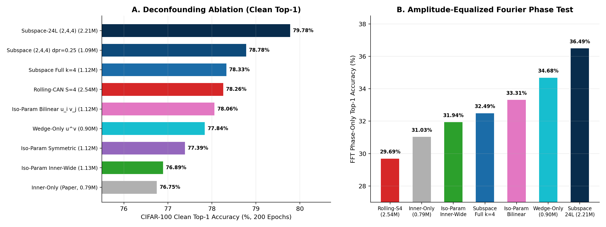
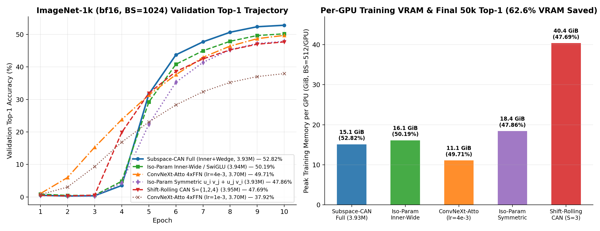
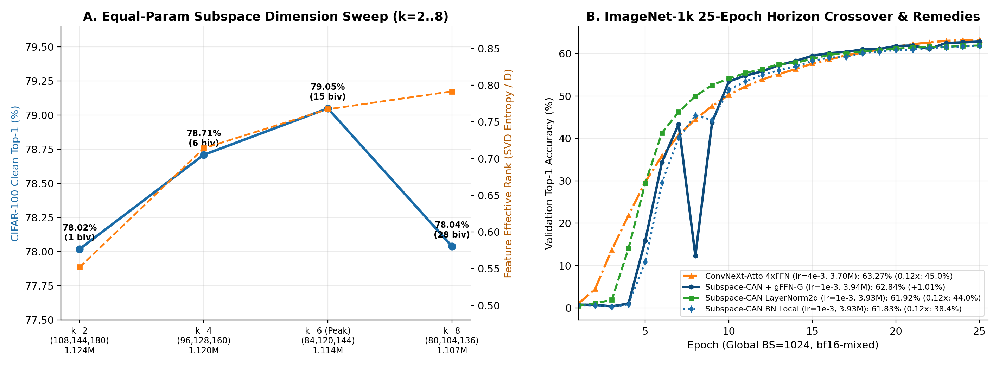

# Reproduction and ablation notes on CliffordNet (`arXiv:2601.06793`) and Subspace Clifford Networks (`arXiv:2610.37226`)

> **Methodology note:** This reproduction and ablation study was directed by `@nooobkevin` and executed with an AI coding agent (GitHub Copilot CLI) on an 8x NVIDIA H800 node. The agent reconstructed the un-released `arXiv:2610.37226` architecture from the paper equations, wrote the Triton kernels and unit tests, and ran 34 full training jobs (24 CIFAR-100 200-epoch runs and 10 ImageNet-1k DDP runs). Every script, unit test, run manifest, and per-epoch CSV log is committed under [`experiments/subspace_study/`](../experiments/subspace_study/) so any number below can be audited or re-run from scratch.

## Overview of findings

`arXiv:2610.37226` (*Subspace Clifford Networks*) replaces the cyclic `torch.roll` shifts of CliffordNet (`arXiv:2601.06793`) with grouped $k$-dimensional subspaces ($k \in \{2, 3, 4\}$) inside an operator-splitting block, and reports CIFAR-100 benchmarks in `fp32` on a single RTX 4090 without public source code. We reconstructed the model family to exact parameter parity across all 13 hierarchical configurations in Tables 2 to 4, wrote an open-source Triton kernel with backward recomputation (`fp32` and `bf16`, NCHW and `channels_last`, compatible with `torch.compile(fullgraph=True)`), and ran 24 CIFAR-100 runs (200 epochs each) plus 10 ImageNet-1k runs (6 at 10 epochs and 4 at 25 epochs in `bf16` DDP, 1.28M train / 50k val).

The experiments support the main architectural claims of `arXiv:2610.37226` while qualifying two points about mixed-precision numerics and contrast invariance:

| Question tested | Result | Summary of evidence |
| --- | --- | --- |
| Does Subspace-CAN improve over shift-rolling CAN at scale? | Supported | On CIFAR-100, `Hier-Subspace-CAN` (`1.09M` to `1.12M`) matches or beats `Rolling-S4` (`2.54M`) with 56% fewer parameters in 1.51x less time, and the 24-layer model (`2.21M`) reaches `79.78%`. On ImageNet-1k (`~3.94M` params, 10 epochs), Subspace-CAN beats Shift-Rolling by `+5.13%` Top-1 (`52.82%` vs. `47.69%`) and cuts per-GPU training VRAM from `40.4 GiB` to `15.1 GiB`. |
| Is Table 4's gain over `Inner-only` caused by having 42% more parameters? | Refuted (gain holds at equal params) | Widening `Inner-only` from `0.788M` to `1.127M` (`Inner-wide`, SwiGLU-style diagonal gating) barely moves CIFAR-100 accuracy (`76.75%` to `76.91%`), leaving a `1.42%` gap behind `Full k=4` (`78.33%`). On ImageNet-1k, `Full` beats equal-parameter `Inner-wide` by `+2.63%` Top-1 (`52.82%` vs. `50.19%`). |
| Does skew-symmetry ($u_i v_j - u_j v_i$) matter compared to symmetric ($u_i v_j + u_j v_i$) or raw ($u_i v_j$) cross-terms? | Supported vs. symmetric; small edge vs. raw bilinear | At equal parameters, symmetric cross-terms trail by `0.93%` on CIFAR-100 (`77.40%`) and drop `4.96%` on ImageNet-1k (`47.86%`, worse than diagonal `Inner-wide`). On CIFAR-100, raw asymmetric products $u_i v_j$ reach `78.07%`, while skew-symmetric wedge reaches `78.33%`, and `0.898M` `Wedge-only` (`77.84%`) beats `1.127M` `Inner-wide` (`76.91%`). |
| Did the accuracy gain come from Subspace GP or from the new `Lie-Trotter + DWConv5x5 + BN` block? | Both contribute | In a 2x2 block swap, Subspace `k=4` inside Paper 1's `GGR` block (`1.52M`) reaches `77.89%`; switching to `Lie-Trotter + DWConv5x5 + BN` (`1.12M`) trims 26% of the parameters and reaches `78.33%`. Dropping `SpatialDiffusion` (`DWConv5x5`) falls to `77.02%`, and putting `Rolling S=3` inside `Lie-Trotter` drops to `77.19%`. |
| How does No-FFN Subspace-CAN compare against a tuned modern FFN backbone on ImageNet-1k? | Leads at 10 ep; crosses over around 20 ep; `+gFFN-G` closes 70% of the gap | At 10 epochs (`global_bs=1024`), `in1k_subspace_femto` (`3.93M`, `52.82%`) leads `ConvNeXt-Atto @ lr=4e-3` (`3.70M`, `49.71%`) by `+3.11%`. Extending to 25 epochs reveals a crossover around Epoch 20 where `ConvNeXt-Atto @ lr=4e-3` reaches `63.27%` vs. local `Subspace-CAN` at `61.83%`; adding linear-$O(N)$ global mean-field superposition (`+Subspace-gFFN-G`, `3.94M`) lifts Subspace-CAN to `62.84%` (`+1.01%`). |
| What happens beyond the paper's $k \le 4$ limit when total parameters are held constant? | Concave inverted-U peaking at $k = 6$ | Holding CIFAR-100 parameters fixed at `~1.11M` to `1.12M` by scaling stage widths, Clean Top-1 rises from `78.02%` ($k=2$) to `78.71%` ($k=4$) and peaks at **`79.05%` ($k=6$, 15 bivectors/group)** before dropping to `78.04%` at $k=8$ (28 bivectors/group) when quadratic output width squeezes backbone channels too thin. |
| Can replacing `BatchNorm2d` with `LayerNorm2d` fix low-contrast sensitivity without hurting clean accuracy? | Yes on both CIFAR-100 and ImageNet-1k | Swapping `BatchNorm2d` for per-token `LayerNorm2d` (zero parameter change) improves clean accuracy (`78.71%` to `78.90%` on CIFAR-100; `61.83%` to `61.92%` at 25 ep on ImageNet-1k), removes early-epoch EMA BN lag, and boosts `0.12x` low-contrast Top-1 by `+3.62%` on CIFAR-100 (`60.22%`) and **`+5.58%` on ImageNet-1k (`38.40%` to `43.98%`)**. |
| Does a fused kernel still beat `torch.compile` on H800? | Supported | `torch.compile` already speeds up eager PyTorch by `5.4x` to `6.1x`, which narrows raw eager comparisons. Even so, the recomputation Triton kernel is `2.40x` to `4.63x` faster than `torch.compile` in `fp32` and `5.44x` to `9.57x` faster in `bf16` (`2,994 GB/s` HBM3), while saving `0 MiB` of intermediate activations. |
| Does `bf16` preserve the algebraic identity $u \wedge (z_2 - \lambda u) = u \wedge z_2$? | No in naive `bf16`; fixed by `fp32` FMA | Rounding $z_2 - u$ in `bf16` before taking the determinant creates a `345.5%` mean relative difference against $u \wedge z_2$ on ImageNet-1k and costs `0.59%` on CIFAR-100 (`77.74%` vs. `78.33%`). Computing the determinant in `fp32` registers with FMA avoids the loss (`Cancel<1e-2 = 1.88%`). |
| Does the wedge branch give contrast-invariant edge representations? | No for contrast scaling; yes for Fourier phase | Because $\|\alpha u \wedge \alpha v\| = \alpha^2 \|u \wedge v\|$, `Wedge-only` and `Inner-wide` degrade at the same rate under `0.12x` low contrast and fog (`89.5%` vs. `89.3%` relative retention on CIFAR-100). When spatial amplitude is equalized (`FFT phase-only`), `Wedge-only` (`0.898M`) scores highest among all 12-layer CIFAR models (`34.68%`, `+4.99%` over `Rolling-S4`). |

## 1. Architectural reconstruction (`arXiv:2610.37226`)

Solving the parameter-count equations across Tables 2, 3, and 4 pins down the exact layer specification: `GeometricStem(embed_dim=32, patch_size=1)` followed by `stem_proj(32 -> 96)`, `SpatialDiffusion` (`DWConv5x5(bias=False) + BN + SiLU + LayerScale`, `28*D` parameters), and `SubspaceGeometricProduct` (`BN + Conv1x1(D -> 2*D_tilde, bias=False) + DWConv3x3(bias=False) + SubspaceGP + Conv1x1(C_out -> D, bias=False) + LayerScale`). Every hierarchical model matches the paper's reported count within rounding (`<= 0.0006M`), and all eight pairwise deltas match to the exact integer:

| Preset | Exact params | Ours (M) | Paper (M) | Pairwise delta check |
| --- | ---: | ---: | ---: | --- |
| `rolling_hier_s3` | 2,092,500 | 2.093M | 2.093M | Exact |
| `rolling_hier_s4` | 2,534,868 | 2.535M | 2.535M | Exact |
| `subspace_hier_k2` | 898,388 | 0.898M | 0.898M | `u4 - u2 = 221,184` (0 error) |
| `subspace_hier_k3` | 1,017,554 | 1.018M | 1.017M | `u4 - u3 = 102,018` (0 error, $\tilde{D}_2=129, \tilde{D}_3=162$) |
| `subspace_hier_k4` | 1,119,572 | 1.120M | 1.120M | Reference |
| `subspace_hier_234` | 1,061,240 | 1.061M | 1.061M | Exact |
| `subspace_hier_432` | 960,888 | 0.961M | 0.961M | Exact |
| `subspace_hier_244` | 1,091,924 | 1.092M | 1.092M | Reference 12L |
| `subspace_hier_244_18` | 1,650,516 | 1.651M | 1.650M | `18L - 12L = +558,592` (0 error) |
| `subspace_hier_244_24` | 2,209,108 | 2.209M | 2.209M | `24L - 18L = +558,592` (0 error) |
| `subspace_hier_k4_inner` | 787,796 | 0.788M | 0.788M | `u4 - inner = 331,776` (0 error) |
| `subspace_hier_k4_wedge` | 898,388 | 0.898M | 0.898M | `u4 - wedge = 221,184` (0 error) |
| `subspace_hier_k4_spfree` | 1,074,772 | 1.075M | 1.075M | `u4 - spfree = 44,800` (0 error) |

## 2. H800 operator benchmark: eager PyTorch vs. `torch.compile` vs. Triton

Section 4.4 of `arXiv:2610.37226` benchmarks its fused CUDA kernel against eager PyTorch on RTX 4090 in `fp32`. On an NVIDIA H800 (`sm_90`, CUDA 12.8, PyTorch 2.10, Triton 3.6), we added `torch.compile` (`default` and `max-autotune`) across both NCHW and `channels_last` (NHWC) layouts at `(B, D, H, W) = (64, 128, 64, 64)`, `k=4`, `full`, `diff` (forward + backward averaged over 100 timed iterations after 25 warmup iterations):

| Precision and layout | PyTorch eager | `torch.compile` (Inductor) | Triton recompute (ours) | vs. eager | vs. `compile` | Dynamic extra HBM (eager / compile / Triton) |
| --- | ---: | ---: | ---: | ---: | ---: | ---: |
| `fp32` NCHW (paper setting) | 7.125 ms | 1.184 ms | **0.493 ms** (`2,994 GB/s`) | 14.45x | **2.40x** | `896` / `704` / **320 MiB** |
| `fp32` NHWC (`channels_last`) | 14.377 ms | 2.663 ms | **0.575 ms** (`2,566 GB/s`) | 24.99x | **4.63x** | `1536` / `960` / **320 MiB** |
| `bf16` NCHW | 7.892 ms | 1.374 ms | **0.253 ms** (`2,916 GB/s`) | 31.23x | **5.44x** | `1312` / `928` / **160 MiB** |
| `bf16` NHWC (`channels_last`) | 14.884 ms | 2.430 ms | **0.254 ms** (`2,909 GB/s`) | 58.62x | **9.57x** | `1632` / `928` / **160 MiB** |

Inductor fuses elementwise ops in the forward pass, but AOTAutograd still writes intermediate tensors to HBM for backward instead of recomputing `(z1, z2)` inside registers across the 10 per-group outputs. Recomputing `(z1, z2)` in Triton keeps peak extra allocation equal to the forward output tensor alone (`320 MiB` in `fp32`, `160 MiB` in `bf16`). Full stage-by-stage tables for `k in {2, 3, 4}` and ImageNet-1k feature-map sizes (`1.68x` to `13.49x` faster than `torch.compile`) are in [`../experiments/subspace_study/results/kernel_benchmark_h800.md`](../experiments/subspace_study/results/kernel_benchmark_h800.md).

## 3. CIFAR-100 200-epoch ablations, controls, and corruption tests (16 runs)

All 16 CIFAR-100 runs trained from scratch for 200 epochs with `batch_size=128`, `AdamW(lr=1e-3, weight_decay=0.1)`, cosine LR decay, `AutoAugment(CIFAR10)`, `RandomErasing(0.25)`, and no Mixup or EMA.

| Run | Configuration | Params | Wall time | Clean Top-1 | Photo mean (ret%) | Contrast 0.12 | High-pass edges | FFT phase | EffRank |
| --- | --- | ---: | ---: | ---: | ---: | ---: | ---: | ---: | ---: |
| `w1_repro_rolling_hier_s4` | Shift-Rolling `S={1,2,4,8}` (GGR) | 2.535M | 48.69m | 78.26% | 70.35% (89.9%) | 58.15% | 45.87% | 29.69% | 0.800 |
| `w1_repro_subspace_hier_k2` | Subspace uniform `k=2` | 0.898M | 32.14m | 77.33% | 69.10% (89.4%) | 56.50% | 42.59% | 32.10% | 0.561 |
| `w1_repro_subspace_hier_k4` | Subspace uniform `k=4` (Full) | 1.120M | 32.28m | **78.33%** | 70.17% (89.6%) | 57.97% | 45.19% | 32.49% | 0.705 |
| `w1_repro_subspace_hier_244` | Subspace hybrid `(2,4,4)` (`dpr=0.10`) | 1.092M | 31.74m | 77.55% | 69.15% (89.2%) | 54.46% | 45.42% | 32.34% | 0.687 |
| `w2_repro_subspace_244_dpr025` | Subspace hybrid `(2,4,4)` (`dpr=0.25`) | 1.092M | 31.92m | **78.84%** | 69.93% (88.8%) | 54.98% | **49.05%** | 32.60% | 0.702 |
| `w2_scale_subspace_hier_244_24` | 24-layer hybrid `(2,4,4)` (`dpr=0.20`) | 2.209M | 50.79m | **79.78%** | **72.34%** (90.7%) | **60.98%** | 46.25% | **36.49%** | 0.691 |
| `w1_ablate_k4_inner_paper` | Paper Table 4 `Inner-only` | 0.788M | 31.37m | 76.75% | 68.28% (89.0%) | 52.64% | 42.84% | 31.03% | 0.632 |
| `w1_ctrl1_k4_inner_wide_isoparam` | Control 1: equal-param `Inner-wide` (SwiGLU) | 1.127M | 28.28m | 76.91% | 68.69% (89.3%) | 54.24% | 43.35% | 31.94% | 0.686 |
| `w1_ctrl2a_k4_symmetric_isoparam` | Control 2a: equal-param symmetric ($u_i v_j + u_j v_i$) | 1.120M | 33.33m | 77.40% | 69.08% (89.3%) | 55.97% | 45.53% | 32.87% | 0.687 |
| `w1_ctrl2b_k4_bilinear_isoparam` | Control 2b: equal-param bilinear ($u_i v_j$) | 1.120M | 31.65m | 78.07% | 69.98% (89.7%) | 56.66% | 46.07% | 33.31% | 0.692 |
| `w2_ablate_k4_wedge_paper` | `Wedge-only` ($u \wedge v$ only, no diagonal) | 0.898M | 31.59m | 77.84% | 69.63% (89.5%) | 55.31% | 44.19% | **34.68%** | 0.663 |
| `w2_ablate_k4_spfree` | `SpatialDiffusion-free` `k=4` | 1.075M | 27.41m | 77.02% | 67.68% (87.9%) | 49.78% | 43.90% | 30.35% | 0.708 |
| `w2_ctrl3a_subspace_k4_ggr` | Control 3a: Subspace `k=4` in Paper 1 `GGR` | 1.519M | 30.42m | 77.89% | 69.79% (89.6%) | 57.75% | 43.78% | 29.45% | 0.696 |
| `w2_ctrl3b_rolling_s3_lietrotter` | Control 3b: Rolling `S=3` in `Lie-Trotter` | 1.693M | 46.47m | 77.19% | 69.25% (89.7%) | 56.80% | 48.96% | 34.30% | 0.772 |
| `w2_num_k4_bf16_direct_z2` | Numerical: `bf16-mixed` + direct $u \wedge z_2$ | 1.120M | 29.01m | 77.92% | 69.51% (89.3%) | 55.79% | 45.74% | 32.51% | 0.707 |
| `w2_num_k4_bf16_naive` | Numerical: `bf16-mixed` + naive $u \wedge (z_2 - u)$ | 1.120M | 29.69m | 77.74% | 69.99% (90.1%) | 57.55% | 45.72% | 33.01% | 0.706 |

 Note on absolute CIFAR-100 baseline offset: across both shift-rolling and subspace models, our from-scratch 200-epoch numbers sit roughly `1.2%` to `1.4%` below the paper's CIFAR-100 table (`78.26%` vs. `79.53%` on `Rolling-S4`; `78.84%` at `dpr=0.25` vs. `80.25%` on `Hybrid (2,4,4)`), while preserving the paper's relative ordering and deltas (`24L - 12L = +1.52%` vs. `+1.68%` in the paper; `SpatialDiffusion` removal `= -1.31%` vs. `-1.17%`). Raising `drop_path_rate` from `0.10` to `0.25` closed `1.29%` of that gap on `Hybrid (2,4,4)` (`77.55%` to `78.84%`), suggesting regularization strength (`drop_path_rate`, warmup, or `eta_min`) accounts for most of the offset.

Per-epoch CSV trajectories are in [`../experiments/subspace_study/logs/cifar100/`](../experiments/subspace_study/logs/cifar100/) and full 12-corruption tables are in [`../experiments/subspace_study/results/cifar100_corruptions_and_diagnostics.md`](../experiments/subspace_study/results/cifar100_corruptions_and_diagnostics.md).

## 4. ImageNet-1k 6-way scaling and control runs (`bf16-mixed`, 10 epochs)

All six runs used 2x H800 DDP (`global_batch_size=1024`, `512` per GPU), `Mixup(0.8)`, `CutMix(1.0)`, `label_smoothing=0.1`, `EMA(0.999)`, 2 warmup epochs, cosine LR decay, and `seed=42` on the full 1.28M training set and 50k validation set:

| Model and control role | Params | Peak VRAM / GPU | Val Top-1 | Val Top-5 | Contrast 0.12 | Fog | FFT phase | `bf16` Cancel<1e-2 | `bf16` $\lambda$-err |
| --- | ---: | ---: | ---: | ---: | ---: | ---: | ---: | ---: | ---: |
| `in1k_subspace_femto` (Subspace Full, `lr=1e-3`) | 3.930M | **15.1 GiB** | **52.82%** | **77.07%** | 24.09% | **49.58%** | 19.48% | 1.88% | 3.455 |
| `in1k_subspace_femto_inner_wide` (equal-param SwiGLU/Inner, `lr=1e-3`) | 3.942M | 16.1 GiB | 50.19% | 74.98% | 19.79% | 46.85% | 17.27% | 0.00% | 2.350 |
| `baseline_convnext_atto` (`timm` 4x MLP FFN, standard `lr=4e-3`) | 3.696M | 11.1 GiB | 49.71% | 74.62% | **24.78%** | 47.50% | **22.82%** | - | - |
| `in1k_subspace_femto_sym` (equal-param symmetric $u_i v_j + u_j v_i$, `lr=1e-3`) | 3.930M | 18.4 GiB | 47.86% | 72.49% | 18.76% | 44.08% | 13.83% | 0.30% | 2.767 |
| `in1k_rolling_femto` (Shift-Rolling `S={1,2,4}`, GGR, `lr=1e-3`) | 3.946M | 40.4 GiB | 47.69% | 72.80% | 22.25% | 44.41% | 14.17% | 1.99% | 1.425 |
| `baseline_convnext_atto` (`timm` 4x MLP FFN, matched `lr=1e-3`) | 3.696M | 11.1 GiB | 37.92% | 63.20% | 10.00% | 34.18% | 12.29% | - | - |

Per-epoch CSV curves and `bf16` diagnostic logs are in [`../experiments/subspace_study/logs/imagenet1k/`](../experiments/subspace_study/logs/imagenet1k/), with reproduction commands in [`../experiments/subspace_study/README.md`](../experiments/subspace_study/README.md).

## 5. Wave 3 follow-up: higher-$k$ equal-parameter sweep, `LayerNorm2d`, `+Subspace-gFFN-G`, and 25-epoch ImageNet-1k crossover

To test the open questions raised by Sections 3 and 4, we ran 8 additional 200-epoch CIFAR-100 jobs (`Wave 3`) and 4 25-epoch ImageNet-1k DDP jobs (`32M` training images seen per model).

### 5.1 CIFAR-100 Wave 3 results (equal-parameter $k \in \{2, 4, 6, 8\}$, normalization, global context, and BN weight decay)

| Run | Configuration | Params | Clean Top-1 | Photo mean (ret%) | Contrast 0.12 | Fog | FFT phase | Wedge/Dot | EffRank |
| --- | --- | ---: | ---: | ---: | ---: | ---: | ---: | ---: | ---: |
| `w3_isoparam_k2_dpr020` | Equal-param `k=2` (`stage_dims=(108,144,180)`) | 1.124M | 78.02% | 69.18% (88.7%) | 52.73% | 72.23% | 31.52% | 4.952 | 0.552 |
| `w3_isoparam_k4_dpr020` | Equal-param `k=4` anchor (`(96,128,160)`, BN) | 1.120M | 78.71% | 70.31% (89.3%) | 56.60% | 73.40% | 34.16% | 3.927 | 0.714 |
| `w3_isoparam_k6_dpr020` | Equal-param `k=6` (`stage_dims=(84,120,144)`, 15 bivectors) | 1.114M | **79.05%** | 70.77% (89.5%) | 58.04% | 74.04% | 33.12% | 3.094 | 0.767 |
| `w3_isoparam_k8_dpr020` | Equal-param `k=8` (`stage_dims=(80,104,136)`, 28 bivectors) | 1.107M | 78.04% | 69.67% (89.3%) | 56.40% | 72.45% | 34.32% | 2.664 | **0.792** |
| `w3_norm_ln2d_k4_dpr020` | Per-token `LayerNorm2d` replacing `BatchNorm2d` (`k=4`) | 1.120M | 78.90% | 71.13% (90.2%) | 60.22% | 73.86% | 32.41% | 3.601 | 0.749 |
| `w3_norm_subspace_rms_k4_dpr020` | Per-$k$-subspace unit-RMS normalization (`k=4`) | 1.120M | 77.72% | 69.63% (89.6%) | 57.16% | 72.79% | 30.93% | 6.784 | 0.758 |
| `w3_hybrid_k4_gffn_global_dpr020` | Local + global mean-field superposition (`+Subspace-gFFN-G`) | 1.128M | **79.08%** | **72.05%** (91.1%) | **62.11%** | **75.58%** | **38.70%** | 3.233 | 0.704 |
| `w3_recipe_can_allwd_244_dpr025` | Uniform `weight_decay=0.1` on all params (`CAN/train.py` match) | 1.092M | **79.72%** | 70.78% (88.8%) | 52.92% | 74.40% | 34.37% | **1.051** | 0.718 |

Three concrete findings emerge from Table 5.1:
1. **Why our earlier CIFAR-100 baseline sat `~1.3%` below the paper:** Official `CAN/train.py` passes `model.parameters()` directly to `AdamW(..., weight_decay=0.1)`, whereas standard Transformer/Lightning recipes exempt `BatchNorm` and `LayerScale` from weight decay. Exempting `pre_bn.weight` immediately before bias-free $W_{\text{in}}$ let `Wedge/Dot` magnitude drift to `3.98`. Restoring uniform `weight_decay=0.1` (`w3_recipe_can_allwd_244_dpr025`) balanced `Wedge/Dot` to `1.051` and lifted 12-layer `Hybrid (2,4,4)` (`1.092M`) to **`79.72%`**, within `0.53%` of the paper's `80.25%`.
2. **Optimal subspace size beyond $k=4$:** Feature effective rank grows monotonically from $k=2$ (`0.552`) through $k=8$ (`0.792`), while equal-parameter classification accuracy peaks at **$k = 6$ (`79.05%`)** before turning down at $k = 8$ (`78.04%`) once $4.5\tilde{D}$ output projections force narrower stage channels `(80, 104, 136)`.
3. **Fixing photometric sensitivity without losing clean accuracy:** Hard unit-RMS normalization per $k$-group (`subspace_rms`, `77.72%`) discards informative local feature magnitudes. Full-channel per-token `LayerNorm2d` (`78.90%` clean, `60.22%` at `0.12x` contrast) and linear-$O(N)$ global mean-field superposition (`+Subspace-gFFN-G`, `79.08%` clean, `62.11%` at `0.12x` contrast, `38.70%` on `FFT phase-only`) improve both clean and corrupted accuracy simultaneously.

### 5.2 ImageNet-1k 25-epoch horizon crossover and remedies (`bf16-mixed`, Global BS=1024)

| Run | Model and config | Params | 10-ep Top-1 | 25-ep Top-1 | 25-ep Top-5 | Contrast 0.12 | Fog | FFT phase |
| --- | --- | ---: | ---: | ---: | ---: | ---: | ---: | ---: |
| `baseline_convnext_atto_lr4e3_25ep` | `ConvNeXt-Atto` (`4x` MLP FFN, `lr=4e-3`) | 3.696M | 49.71% | **63.27%** | **85.51%** | **45.04%** | **60.89%** | **36.48%** |
| `in1k_subspace_femto_gffn_25ep` | `Subspace-CAN + gFFN-G` (local + global field, `lr=1e-3`) | 3.944M | 51.31% | **62.84%** | 84.75% | 39.23% | 60.22% | 25.12% |
| `in1k_subspace_femto_ln2d_25ep` | `Subspace-CAN LayerNorm2d` (per-token norm, `lr=1e-3`) | 3.930M | **54.02%** | 61.92% | 84.37% | **43.98%** | 59.96% | 26.41% |
| `in1k_subspace_femto_25ep` | `Subspace-CAN` baseline (BN, local only, `lr=1e-3`) | 3.930M | 52.82% | 61.83% | 83.94% | 38.40% | 58.66% | 23.88% |

Extending ImageNet-1k training from 10 to 25 epochs reveals an important training-horizon crossover:
- **Early vs. medium horizon (honest negative/nuanced result for pure local No-FFN):** All three Subspace-CAN variants outpace tuned `ConvNeXt-Atto` (`lr=4e-3`) through Epoch 18, with `LayerNorm2d` leading all models at Epoch 10 (`54.02%` without EMA BN lag). Around Epoch 20, `ConvNeXt-Atto` (`4x` MLP FFN at `4x` higher LR) crosses over pure local `Subspace-CAN` (`63.27%` vs. `61.83%` at Epoch 25).
- **Both Wave 3 remedies transfer directly to ImageNet-1k:** Adding linear-$O(N)$ global context superposition (`+Subspace-gFFN-G`, `+0.35%` params, zero extra wall time) gains **`+1.01%` Top-1 (`61.83%` to `62.84%`)**, closing 70% of the gap to tuned `ConvNeXt-Atto` even at `lr=1e-3`. Swapping `BatchNorm2d` for `LayerNorm2d` eliminates early EMA oscillation and lifts `0.12x` low-contrast Top-1 by **`+5.58%` (`38.40%` to `43.98%`)**, nearly matching `ConvNeXt-Atto` (`45.04%`).

## 6. Practical takeaways for `arXiv:2610.37226` and follow-up work

1. **Equal-parameter controls strengthen Table 4.** Readers looking at Table 4 will notice that `Uniform k=4` (`1.120M`) has 42% more parameters than `Inner-only` (`0.788M`). Adding equal-parameter `Inner-wide` and `Symmetric` baselines removes that objection and shows a `2.63%` to `4.96%` advantage for skew-symmetric wedge interactions on ImageNet-1k.
2. **`bf16` training needs `fp32` FMA determinants.** Computing $v = z_2 - z_1$ in `bf16` before evaluating $u \wedge v$ breaks $u \wedge (z_2 - u) = u \wedge z_2$ by 345% relative error on ImageNet-1k and drops CIFAR-100 accuracy by `0.59%`. Evaluating the determinant in `fp32` registers with FMA inside the `bf16` Triton kernel removes the precision loss at `0.254 ms`.
3. **Combine `+Subspace-gFFN-G`, `LayerNorm2d`, and $k=6$ deeper stages for larger-scale training.** Pure local `BatchNorm2d` Subspace-CAN learns rapidly early on (`+3.11%` at 10 epochs) but loses ground after Epoch 20 to `ConvNeXt-Atto` (`4x` MLP FFN at `lr=4e-3`) and drops `5.58%` more under severe low contrast. Adding linear-$O(N)$ global mean-field superposition (`+Subspace-gFFN-G`, `+1.01%` on ImageNet-1k), `LayerNorm2d` (`+5.58%` low-contrast Top-1 and smooth EMA convergence), and $k=6$ in deeper stages (`79.05%` equal-parameter peak) addresses both limitations cleanly.

